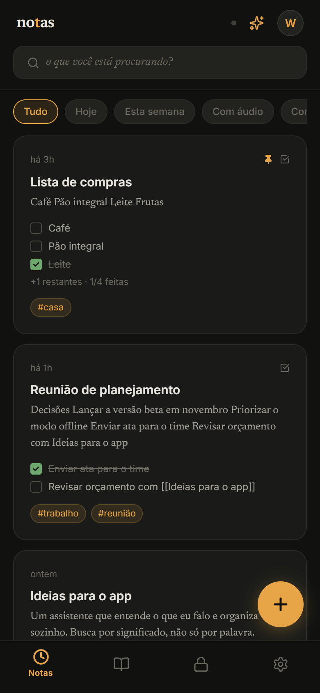
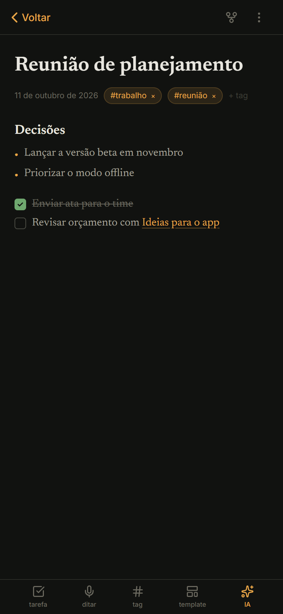
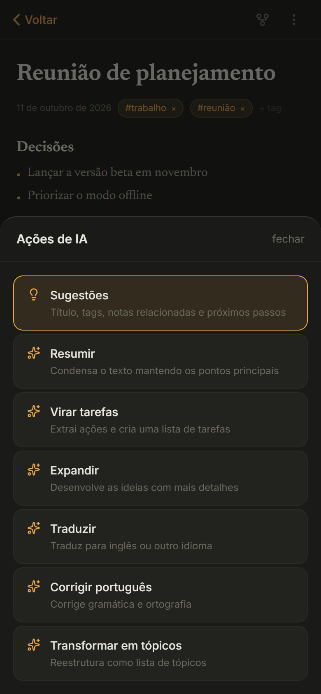
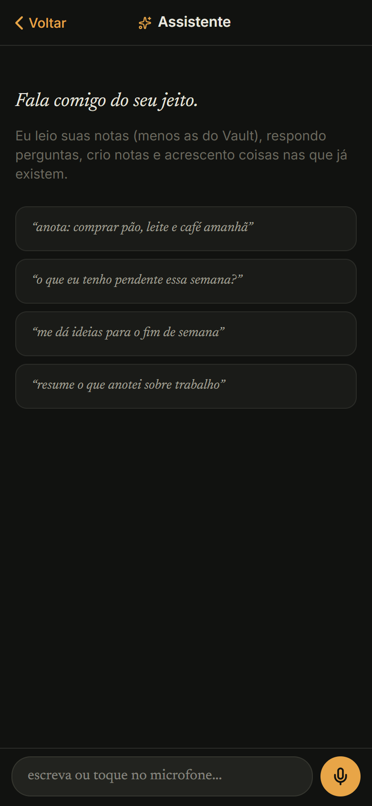
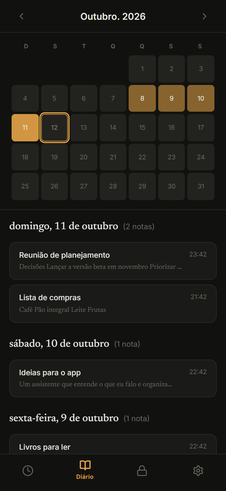
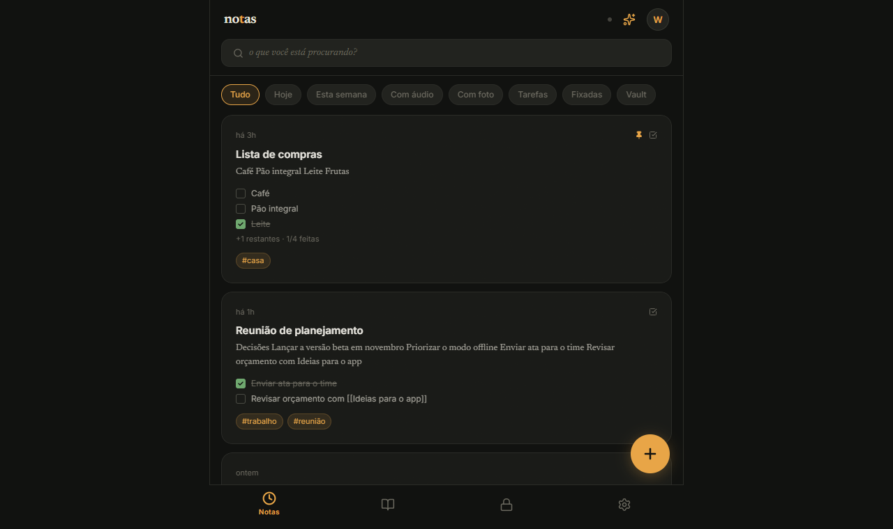

# Grafite Notas

App de notas pessoais **local-first**, instalável no celular (PWA), com sincronização entre aparelhos e um **assistente de IA que entende o que você fala**. Visual próprio, "Grafite Premium": fundo grafite, acento âmbar e tipografia serif/sans.

**🔗 No ar:** https://notes-ten-tau-15.vercel.app/

<p>
  
  
  
</p>

## O que ele faz

- **Funciona sem internet.** As notas ficam primeiro no aparelho (IndexedDB) e sincronizam com a nuvem quando há conexão.
- **Sincroniza entre celular e PC** pelo MongoDB Atlas. Em conflito, vence a edição mais recente.
- **Assistente de IA (Google Gemini).** Você fala ou digita do seu jeito: ele responde perguntas sobre as suas notas, cria notas novas, acrescenta itens em notas existentes ("põe café na lista de compras") e dá sugestões. Toda ação espera sua confirmação.
- **IA no editor:** sugestões (título, tags, notas relacionadas, próximos passos), resumir, virar tarefas, expandir, traduzir, corrigir o português e organizar em tópicos.
- **Ditado por voz** em português, usando o reconhecimento do próprio navegador.
- **Notas ligadas** com `[[wikilinks]]`, backlinks ("mencionada em") e mapa de conexões.
- **Diário com heatmap**, busca por texto, tags e datas, tarefas com checkbox, templates e notas fixadas.
- **Vault**, para notas que ficam fora da timeline, da busca e da IA.
- **Atualiza sozinho:** depois de cada deploy, o app instalado detecta a versão nova e recarrega.
- **Celular e PC:** mobile-first; em telas largas, vira uma coluna central de leitura.

<p>
  
  
</p>


## Custo: zero

| Peça | Serviço | Plano |
|---|---|---|
| Hospedagem | Vercel | Hobby (grátis) |
| Banco de dados | MongoDB Atlas | M0 (grátis, 512 MB) |
| IA | Google Gemini | Gratuito, sem cartão |
| Voz | Web Speech API do navegador | Grátis |

> No plano gratuito do Gemini, o Google pode usar o texto enviado para melhorar os modelos. Por isso, as notas do Vault **nunca** são enviadas para a IA.

## Stack

Next.js 16 (App Router) · React 19 · TypeScript · Tailwind CSS 4 · Framer Motion · Zustand · Dexie (IndexedDB) · MongoDB driver · `@google/genai` · Service Worker próprio.

## Rodando localmente

```bash
git clone https://github.com/Wellerson-M/Notes.git
cd Notes
npm install
cp .env.example .env.local   # preencha as variáveis (veja abaixo)
npm run dev                  # http://localhost:3000
```

| Variável | Para quê | Obrigatória |
|---|---|---|
| `MONGODB_URI` | String de conexão do cluster no Atlas | para sincronizar |
| `APP_PASSWORD` | Senha única para entrar no app | para sincronizar e usar a IA |
| `GEMINI_API_KEY` | Chave grátis em https://aistudio.google.com/apikey | para a IA |
| `MONGODB_DB` / `GEMINI_MODEL` | Nome do banco / modelo (padrões: `grafite-notas` / `gemini-flash-latest`) | não |

Sem nenhuma variável o app ainda funciona, mas só no aparelho, sem nuvem e sem IA.

## Comandos

```bash
npm run dev      # desenvolvimento (service worker desligado)
npm run build    # build de produção, precisa passar antes de commitar
npm run start    # serve o build
npm run lint     # ESLint
npm run e2e      # teste ponta a ponta no Chrome (veja docs/TESTES.md)
```

## Documentação

| Documento | Conteúdo |
|---|---|
| [docs/ROADMAP.md](docs/ROADMAP.md) | **Comece por aqui:** estado atual, o que falta e a ordem sugerida |
| [docs/ARQUITETURA.md](docs/ARQUITETURA.md) | Como os dados fluem: banco local, sync, login, IA, offline e atualização |
| [docs/DEPLOY.md](docs/DEPLOY.md) | Passo a passo de Vercel, Atlas e Gemini, e o que fazer quando algo quebra |
| [docs/TESTES.md](docs/TESTES.md) | Teste automatizado e roteiro de teste manual no celular |
| [docs/DESIGN.md](docs/DESIGN.md) | Regras da identidade visual "Grafite Premium" |
| [docs/spec/](docs/spec/) | Especificações originais do projeto |
| [CLAUDE.md](CLAUDE.md) | Regras rápidas para assistentes de código (Claude, Copilot etc.) |

## Licença

Projeto pessoal, sem licença de uso definida.
